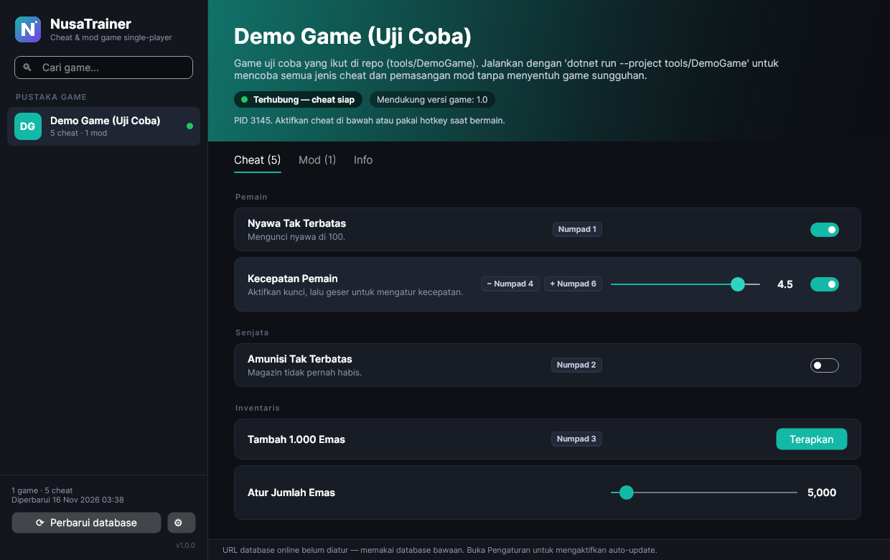
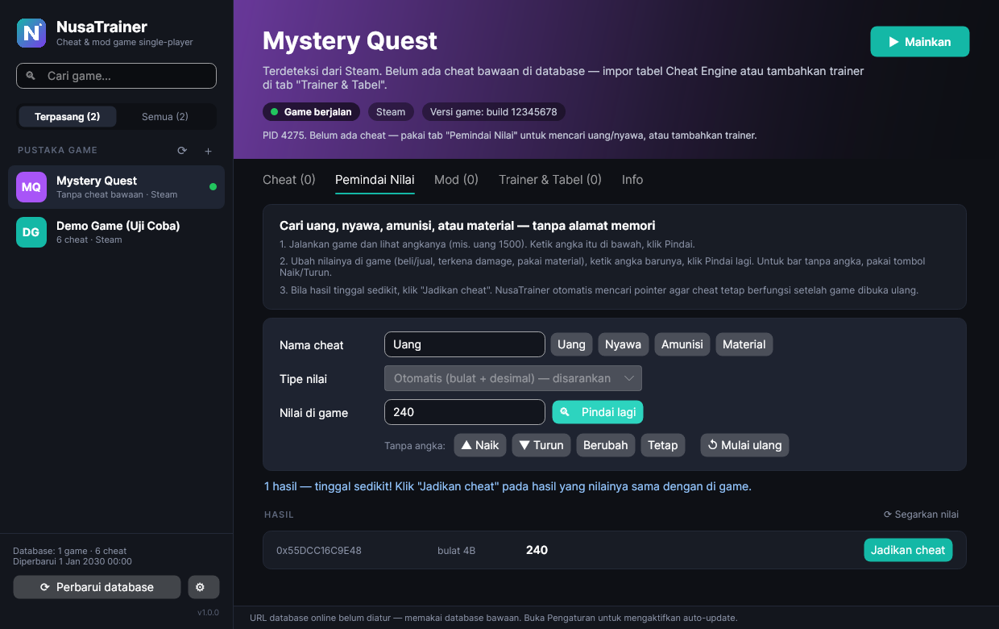
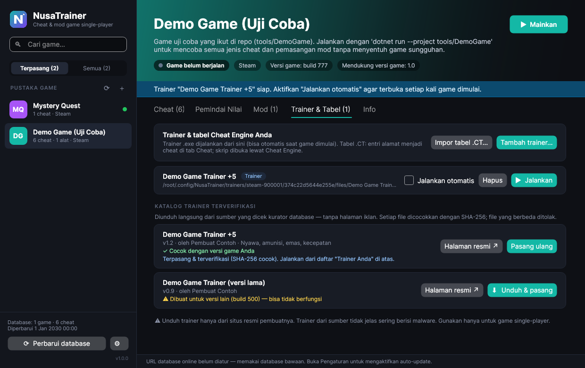
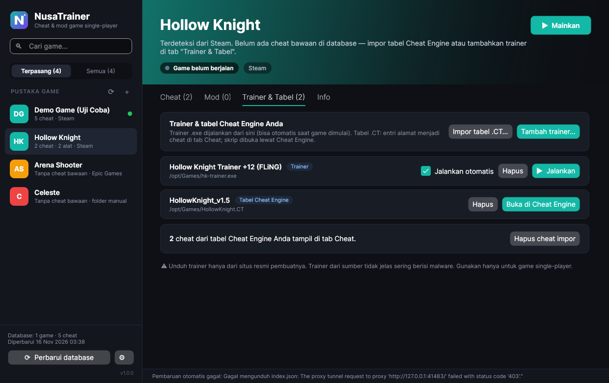
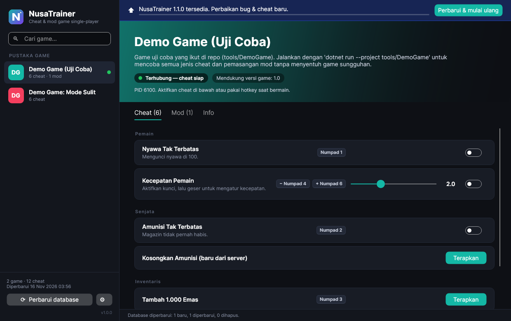

# NusaTrainer

Aplikasi **cheat & mod untuk game PC Windows (single-player)** dengan database yang **diperbarui otomatis** — konsepnya mirip WeMod: satu aplikasi, pustaka game, tombol on/off untuk tiap cheat, hotkey global, dan manajer mod.



## Fitur

| | |
|---|---|
| 📚 **Pustaka game otomatis** | Memindai game terpasang dari **Steam** (semua library), **Epic Games**, dan **GOG**, plus game yang ditambah manual (.exe). Game yang ada di database langsung mendapat cheat-nya. |
| 🎮 **Deteksi game berjalan** | Begitu game dijalankan, NusaTrainer menemukan prosesnya dan langsung terhubung. |
| 🔍 **Pemindai Nilai** | Cari uang, nyawa, amunisi, atau material **tanpa alamat memori**: ketik angka yang terlihat di game, ubah di game, pindai lagi (2–3 langkah) → "Jadikan cheat". Pointer permanen dicari otomatis agar cheat tetap berfungsi setelah game dibuka ulang. Untuk bar tanpa angka: Naik/Turun/Berubah/Tetap. |
| 🧰 **Trainer eksternal** | Tambahkan trainer .exe per game; jalankan dari aplikasi atau otomatis saat game dimulai. |
| ⬇️ **Katalog trainer terverifikasi** | Tombol "Unduh & pasang" dari URL langsung yang dikurasi di database (tanpa halaman iklan), diverifikasi SHA-256, dan diberi tanda cocok/tidak cocok dengan **versi game terdeteksi** (versi exe / build Steam). |
| 📄 **Impor tabel Cheat Engine (.CT)** | Entri alamat/pointer menjadi cheat bawaan (lihat nilai, ubah, kunci — termasuk hotkey dari tabel). Tabel berisi skrip dibuka lewat Cheat Engine dengan satu klik. |
| 🔘 **Cheat toggle / slider / tombol / angka** | Kunci nilai (nyawa, amunisi), atur lewat slider (kecepatan), tambah sekali klik, atau "Edit Emas": lihat nilai sekarang, ketik nilai baru, kunci. |
| 🧬 **Tiga cara menemukan alamat** | Pointer statis ala Cheat Engine (`module+offset → [ptr]+off…`), **AOB scan** dengan wildcard (tahan update game), dan alamat relatif-RIP. |
| 🩹 **Patch kode** | NOP/ganti instruksi dengan verifikasi byte asli; otomatis dikembalikan saat cheat dimatikan atau aplikasi ditutup. |
| ⌨️ **Hotkey global** | Bekerja saat game sedang fokus (mis. `Numpad 1`, `Ctrl+F2`). |
| 📦 **Manajer mod** | Unduh → verifikasi SHA-256 → pasang ke folder game. File asli dicadangkan dan dikembalikan saat mod dicopot. Deteksi bentrok antar-mod & proteksi *zip-slip*. |
| 🔄 **Auto-update database** | Saat aplikasi dibuka dan tiap 6 jam: hanya file yang berubah yang diunduh. |
| 🔏 **Database ditandatangani** | `index.json` ditandatangani ECDSA P-256; setiap file diverifikasi SHA-256. Database palsu/ diubah orang lain **ditolak**. |
| ⬆️ **Self-update aplikasi** | Banner "versi baru tersedia" → unduh, verifikasi, pasang, buka ulang. |
| 🛡️ **Khusus single-player** | Menolak game bertanda online dan game yang memuat anti-cheat (EAC, BattlEye, Vanguard, dll.) — termasuk tidak menjalankan trainer/tabel untuk game tersebut. |









### Dari mana cheat-nya?

1. **Pemindai Nilai** — pengguna menemukan sendiri uang/nyawa/material dalam beberapa langkah, tanpa alamat memori.
2. **Database NusaTrainer** (auto-update) — cheat yang sudah diuji, ditulis komunitas Anda sendiri. Tabel Cheat Engine komunitas bisa diubah menjadi entri database dengan `nusa-db import-ct` (dengan izin pembuat tabel).
3. **Tabel Cheat Engine milik pengguna** — impor .CT langsung di aplikasi.
4. **Trainer eksternal** — dari katalog terverifikasi (unduh langsung + SHA-256) atau file milik pengguna sendiri.

NusaTrainer **tidak** memakai atau menyalin database/trainer WeMod (konten berbayar dan berhak cipta), dan tidak melakukan *scraping* atau melewati iklan situs trainer. Unduhan otomatis hanya dari URL yang dimasukkan kurator database (sebaiknya dengan izin pembuat trainer) dan selalu diverifikasi SHA-256.

## Mulai cepat (Windows)

1. Unduh `NusaTrainer-x.y.z-win-x64.zip` dari halaman **Releases**, ekstrak, jalankan `NusaTrainer.exe` (akan meminta hak Administrator — dibutuhkan untuk membaca/menulis memori game).
2. Coba dengan game uji coba yang ikut di zip: jalankan `DemoGame\DemoGame.exe`.
3. NusaTrainer otomatis terhubung ke **Demo Game (Uji Coba)** — nyalakan *Nyawa Tak Terbatas* (atau tekan **Numpad 1**) dan lihat nyawa di jendela DemoGame terkunci di 100.

## Membangun dari source

Butuh [.NET 8 SDK](https://dotnet.microsoft.com/download/dotnet/8.0).

```bash
dotnet build
```

```bash
dotnet run --project src/NusaTrainer.App
```

```bash
dotnet run --project tools/DemoGame
```

Paket rilis (self-contained, tidak perlu .NET terpasang):

```bash
dotnet publish src/NusaTrainer.App -c Release -r win-x64 --self-contained true -p:PublishSingleFile=true -o publish/NusaTrainer
```

Test (termasuk uji integrasi yang menjalankan DemoGame sungguhan lalu mengubah memorinya):

```bash
dotnet build tools/DemoGame && dotnet test
```

## Mengaktifkan auto-update (sekali saja)

Database di-host gratis di **GitHub Pages** dan ditandatangani otomatis oleh GitHub Actions.

1. Buat kunci tanda tangan: `dotnet run --project tools/DbTool -- keygen --out keys`
2. GitHub repo → **Settings → Secrets and variables → Actions** → secret `NUSA_DB_PRIVATE_KEY` = isi `keys/private.pem`. **Jangan commit `keys/`** (sudah ada di `.gitignore`).
3. **Settings → Pages → Source: GitHub Actions**.
4. Isi `src/NusaTrainer.App/appsettings.json`: `databaseUrl` = `https://<username>.github.io/<repo>/` dan `publicKeyPem` = isi `keys/public.pem`. Build ulang/rilis aplikasi.

Setelah itu, alurnya: **edit/tambah file di `database/games/` → push ke `main` → workflow *Publish Database* menandatangani & mempublikasikan → semua aplikasi mengambilnya otomatis.**

Rilis aplikasi baru: buat tag `v1.1.0` → workflow *Build & Release* membuat GitHub Release; salin cuplikan `app-release.json` dari catatan rilis ke `database/app-release.json` lalu push — pengguna akan melihat banner pembaruan.

Panduan lengkap menulis cheat & mod (termasuk cara mencari alamat dengan Cheat Engine): **[docs/DATABASE.md](docs/DATABASE.md)**.

## Struktur proyek

```
src/NusaTrainer.Core     Mesin trainer (memori, AOB scan, sesi cheat), database & updater, mod installer
src/NusaTrainer.App      Aplikasi desktop (Avalonia UI): pustaka, cheat, mod, pengaturan, hotkey, self-update
tools/DbTool             CLI `nusa-db`: keygen, validate, build (hash + tanda tangan), hash, import-ct
tools/DemoGame           Game uji coba untuk mencoba trainer dengan aman
database/                Database cheat/mod (juga dibundel ke aplikasi sebagai database offline)
tests/                   Unit test + uji integrasi
```

## Penggunaan yang bertanggung jawab

NusaTrainer dibuat untuk bersenang-senang di **game single-player**. Aplikasi sengaja menolak terhubung ke game online/kompetitif atau game yang memuat anti-cheat — curang di sana merugikan pemain lain dan bisa membuat akun Anda di-ban. Selalu simpan (save) game sebelum memakai cheat. Hormati lisensi game dan hak cipta pembuat mod: hanya distribusikan mod yang diizinkan pembuatnya.
